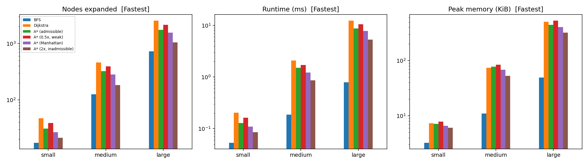
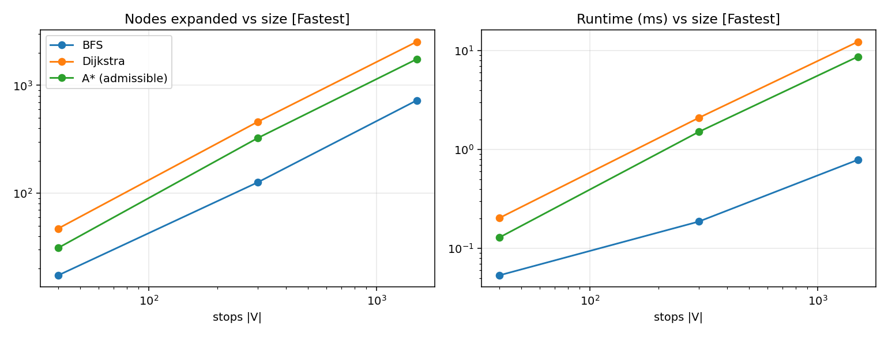
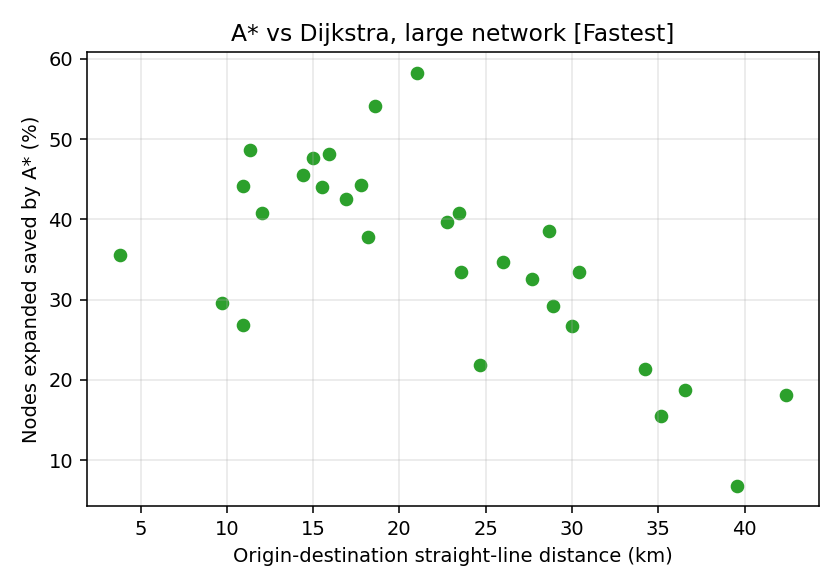

# Public Transport Route Planner — Project Report

*Applied AI Project Track · Classical search (BFS, Dijkstra, A\*) on a transit graph*

All numbers below are generated by `run_experiments.py` + `make_report.py` from
`results/*.csv` (30 origin-destination pairs per network, runtime = median of 3 runs,
memory = peak `tracemalloc` of one run).

## 1. Problem formulation (summary of proposal §4)

* **Graph** G = (V, E): V = stops; E = ride edges *(u → v on route r)* with travel time and fare.
* **State** s = (stop, route). The route component is needed because transferring costs
  waiting time + a boarding fee + a transfer penalty, which a stop-only state cannot express.
  The initial state is (origin, ∅); the goal test is `stop == destination`.
* **Actions / successors**: *board* a route at the origin, *ride* to the next stop on the current route,
  *transfer* to another route serving the same stop.
* **Path cost**: C = α·T + β·R + γ·K (time in min, transfers, fare). Presets:
  Fastest (1,0,0), Cheapest (0,0,1), Fewest transfers (0.05,10,0.01), Balanced (1,5,0.5); the app also exposes custom weights.


**PEAS.** *Performance:* low travel time, fare and transfers, valid route, low search effort. *Environment:* stops, routes, travel times, fares
(static, discrete, known, single-agent, sequential in the prototype). *Actuators:* board / ride / transfer, emit itinerary.
*Sensors:* origin, destination, network data.

**Complexity.** Dijkstra/A\* run in O((|S| + |A|) log |S|) over the |S| ≈ Σ_v (routes at v + 1) states and |A| actions; BFS is O(|S| + |A|) on the stop graph.

## 2. Data

No external dataset was available in the development sandbox (no internet), so the
**controlled synthetic benchmark** allowed by proposal §5 is used. Three networks (seed 42):

| Size | Stops | Routes | Ride edges | Search states |
|---|---|---|---|---|
| small | 40 | 17 | 150 | 132 |
| medium | 300 | 109 | 1594 | 1206 |
| large | 1500 | 542 | 9114 | 6599 |

Generation: random stop coordinates; directionally persistent bus lines over k-nearest neighbours;
fast train lines over a sparse hub subset; feeder lines guarantee full coverage and connectivity;
every edge has a circuity factor in [1.05, 1.30] (roads are never straighter than the crow flies);
buses 18-28 km/h, trains 45-60 km/h; fares = boarding fee + per-km rate (bus 5 + 1.0/km, train 10 + 1.5/km);
waiting time = half the headway.

**Real data:** `transit.load_gtfs()` reads any GTFS feed (directory or .zip) into the same model, and the app
accepts a GTFS upload. It is verified on a miniature feed in `tests/`, but was **not** run on a full city feed here.
GTFS has no fares, so fares come from a per-mode table.

## 3. Heuristic (proposal §7)

h(n) = α·60·d(n,goal)/v_max + γ·c_min·d(n,goal), where v_max and c_min are **measured from the network**
(here v_max = 46.6 km/h, c_min = 1.05/km on the medium network). The β term is 0.

* **Admissible**: by the triangle inequality any path covers ≥ d(n,goal); every edge takes ≥ euclid/v_max minutes
  and costs ≥ c_min·euclid; waiting, boarding fees and transfer penalties are ≥ 0.
* **Consistent**: h(u) − h(v) ≤ (α·60/v_max + γ·c_min)·d(u,v) ≤ w(u,v) on ride edges; boarding/transfer steps leave
  the stop unchanged and have w ≥ 0. So A\* never re-opens a state.
* **Verified computationally** on *every* state-graph edge (5,526 state-graph edges × 10 goal stops, for each of the 2 cost models):
  **0 violations** for the admissible heuristic.

| Cost model | Heuristic | Edges checked | Consistency violations | Worst violation |
|---|---|---|---|---|
| Fastest | Dijkstra | 55260 | 0 | 0.000 |
| Fastest | A* (0.5x, weak) | 55260 | 0 | 0.000 |
| Fastest | A* (admissible) | 55260 | 0 | 0.000 |
| Fastest | A* (Manhattan) | 55260 | 107 | 1.267 |
| Fastest | A* (2x, inadmissible) | 55260 | 271 | 4.573 |
| Balanced | Dijkstra | 55260 | 0 | 0.000 |
| Balanced | A* (0.5x, weak) | 55260 | 0 | 0.000 |
| Balanced | A* (admissible) | 55260 | 0 | 0.000 |
| Balanced | A* (Manhattan) | 55260 | 55 | 0.872 |
| Balanced | A* (2x, inadmissible) | 55260 | 354 | 5.269 |

*Reading the table:* the Manhattan heuristic (L1 distance) and the 2× weighted heuristic **are not consistent** — they
overestimate on some edges, so A\* loses its optimality guarantee. Interesting empirical nuance: Manhattan still found the
optimal route on every sampled pair (see §4), i.e. a violated guarantee is not the same as an observed failure.

Tightness: on the medium network, the average ratio h(origin)/optimal cost is **0.23** — the heuristic is admissible
but loose, because v_max is set by the fastest train while most journeys are by bus and include waiting and transfers.

## 4. Results — objective: minimise travel time (g(n) = Σ travel time as in the proposal)

| Size | Algorithm | Expanded | Generated | Time (ms) | Mem (KiB) | Route time (min) | Transfers | Fare | Optimal (%) | Mean gap (%) |
|---|---|---|---|---|---|---|---|---|---|---|
| small | BFS | 17.30 | 21.87 | 0.05 | 3.23 | 35.47 | 1.63 | 20.10 | 53.33 | 4.73 |
| small | Dijkstra | 47.00 | 59.17 | 0.20 | 7.32 | 33.67 | 1.20 | 18.07 | 100.00 | 0.00 |
| small | A* (admissible) | 31.07 | 43.10 | 0.13 | 7.16 | 33.67 | 1.20 | 18.07 | 100.00 | 0.00 |
| small | A* (0.5x, weak) | 38.93 | 50.87 | 0.16 | 7.84 | 33.67 | 1.20 | 18.07 | 100.00 | 0.00 |
| small | A* (Manhattan) | 26.53 | 38.27 | 0.11 | 6.58 | 33.67 | 1.20 | 18.07 | 100.00 | 0.00 |
| small | A* (2x, inadmissible) | 21.23 | 32.30 | 0.09 | 6.05 | 33.91 | 1.30 | 18.49 | 83.33 | 0.65 |
| medium | BFS | 125.77 | 153.40 | 0.19 | 11.01 | 63.26 | 3.70 | 50.79 | 16.67 | 15.27 |
| medium | Dijkstra | 458.43 | 574.10 | 2.09 | 74.16 | 55.08 | 2.37 | 40.56 | 100.00 | 0.00 |
| medium | A* (admissible) | 323.90 | 437.57 | 1.51 | 77.75 | 55.08 | 2.37 | 40.56 | 100.00 | 0.00 |
| medium | A* (0.5x, weak) | 394.37 | 508.67 | 1.70 | 84.08 | 55.08 | 2.37 | 40.56 | 100.00 | 0.00 |
| medium | A* (Manhattan) | 283.33 | 396.50 | 1.22 | 68.23 | 55.08 | 2.37 | 40.56 | 100.00 | 0.00 |
| medium | A* (2x, inadmissible) | 183.27 | 284.70 | 0.86 | 52.79 | 55.08 | 2.37 | 40.56 | 100.00 | 0.00 |
| large | BFS | 725.63 | 790.50 | 0.79 | 49.23 | 133.06 | 7.33 | 100.23 | 3.33 | 22.53 |
| large | Dijkstra | 2539.00 | 3069.37 | 12.35 | 506.41 | 108.92 | 4.10 | 69.04 | 100.00 | 0.00 |
| large | A* (admissible) | 1751.03 | 2210.37 | 8.72 | 445.81 | 108.92 | 4.10 | 69.04 | 100.00 | 0.00 |
| large | A* (0.5x, weak) | 2144.20 | 2645.57 | 10.56 | 527.38 | 108.92 | 4.10 | 69.04 | 100.00 | 0.00 |
| large | A* (Manhattan) | 1549.50 | 2000.40 | 7.81 | 405.54 | 108.92 | 4.10 | 69.04 | 100.00 | 0.00 |
| large | A* (2x, inadmissible) | 1047.30 | 1436.93 | 5.31 | 319.52 | 108.92 | 4.13 | 69.48 | 96.67 | 0.00 |




### A\* saving over Dijkstra (nodes expanded), by origin-destination distance

| Size | Distance | Dijkstra expanded | A* expanded | Saving (%) |
|---|---|---|---|---|
| small | short | 31.0 | 22.5 | 27.8 |
| small | medium | 53.6 | 34.8 | 39.5 |
| small | long | 56.4 | 35.9 | 35.6 |
| medium | short | 180.3 | 105.0 | 39.5 |
| medium | medium | 448.6 | 289.3 | 36.9 |
| medium | long | 746.4 | 577.4 | 24.1 |
| large | short | 1079.5 | 606.7 | 41.1 |
| large | medium | 2523.3 | 1559.3 | 40.8 |
| large | long | 4014.2 | 3087.1 | 24.1 |



### Balanced objective (α=1, β=5, γ=0.5)

| Size | Algorithm | Expanded | Generated | Time (ms) | Mem (KiB) | Route time (min) | Transfers | Fare | Optimal (%) | Mean gap (%) |
|---|---|---|---|---|---|---|---|---|---|---|
| small | BFS | 17.30 | 21.87 | 0.03 | 3.23 | 35.47 | 1.63 | 20.10 | 46.67 | 10.21 |
| small | Dijkstra | 45.23 | 62.17 | 0.13 | 7.66 | 33.88 | 1.07 | 17.86 | 100.00 | 0.00 |
| small | A* (admissible) | 32.63 | 48.20 | 0.09 | 7.46 | 33.88 | 1.07 | 17.86 | 100.00 | 0.00 |
| small | A* (0.5x, weak) | 38.67 | 54.77 | 0.10 | 8.50 | 33.88 | 1.07 | 17.86 | 100.00 | 0.00 |
| small | A* (Manhattan) | 28.17 | 44.00 | 0.07 | 7.23 | 33.88 | 1.07 | 17.86 | 100.00 | 0.00 |
| small | A* (2x, inadmissible) | 24.10 | 38.90 | 0.06 | 6.78 | 34.00 | 1.13 | 18.11 | 86.67 | 0.93 |
| medium | BFS | 125.77 | 153.40 | 0.15 | 11.01 | 63.34 | 3.70 | 50.63 | 3.33 | 30.64 |
| medium | Dijkstra | 443.40 | 606.90 | 1.83 | 75.32 | 58.39 | 1.67 | 32.04 | 100.00 | 0.00 |
| medium | A* (admissible) | 315.93 | 461.83 | 1.33 | 76.36 | 58.39 | 1.67 | 32.04 | 100.00 | 0.00 |
| medium | A* (0.5x, weak) | 382.37 | 538.33 | 1.71 | 84.67 | 58.39 | 1.67 | 32.04 | 100.00 | 0.00 |
| medium | A* (Manhattan) | 281.37 | 421.80 | 1.20 | 69.97 | 58.39 | 1.67 | 32.04 | 100.00 | 0.00 |
| medium | A* (2x, inadmissible) | 188.63 | 310.43 | 0.81 | 56.37 | 58.39 | 1.67 | 32.04 | 100.00 | 0.00 |
| large | BFS | 725.63 | 790.50 | 0.87 | 49.23 | 133.06 | 7.30 | 100.04 | 0.00 | 38.99 |
| large | Dijkstra | 2496.63 | 3327.83 | 14.16 | 519.00 | 113.53 | 3.27 | 59.38 | 100.00 | 0.00 |
| large | A* (admissible) | 1755.77 | 2437.87 | 10.39 | 467.55 | 113.53 | 3.27 | 59.38 | 100.00 | 0.00 |
| large | A* (0.5x, weak) | 2132.47 | 2886.80 | 12.90 | 541.57 | 113.53 | 3.27 | 59.38 | 100.00 | 0.00 |
| large | A* (Manhattan) | 1557.03 | 2193.37 | 9.36 | 417.86 | 113.53 | 3.27 | 59.38 | 100.00 | 0.00 |
| large | A* (2x, inadmissible) | 1059.23 | 1575.00 | 6.12 | 320.87 | 113.66 | 3.27 | 59.18 | 96.67 | 0.03 |

### Effect of the optimisation criterion (A\*, medium network, 30 pairs)

| Criterion | Travel time (min) | Fare | Transfers | A* nodes expanded |
|---|---|---|---|---|
| Fastest | 55.08 | 40.56 | 2.37 | 323.90 |
| Cheapest | 65.96 | 29.58 | 1.50 | 211.27 |
| Fewest transfers | 62.67 | 31.17 | 1.37 | 313.87 |
| Balanced | 58.39 | 32.04 | 1.67 | 315.93 |

## 5. Findings

1. **A\* is exactly as good as Dijkstra and cheaper.** With the admissible heuristic, A\* returned the optimal route on
   100 % of the 90 queries per cost model (3 networks × 30 pairs) (also checked against NetworkX in the tests) while expanding on average
   **34 % / 34 % / 35 % fewer nodes** (small / medium / large).
   On the large network that is 2539 → 1751 expansions and
   12.3 → 8.7 ms.
2. **The saving is moderate, not dramatic.** Likely causes: the heuristic is loose (see tightness above) and transit graphs are not
   geometric: a vehicle can only follow its line, so straight-line distance says little about the route needed.
3. **BFS is the cheapest to run but gives poor routes.** It expands far fewer nodes
   (726 on the large network) but is optimal on only 3 % of large-network
   queries and its journeys are on average 23 % worse (more transfers: 7.3 vs 4.1).
   Fewest hops ≠ fastest.
4. **Cost of an inadmissible heuristic.** The 2× heuristic expands ~40 % fewer
   nodes than admissible A\* on the large network, but is optimal on only 97 % of queries
   (83 % on the small network, worst case +10.7 % cost). A speed/optimality trade-off.
   A\* with a weaker 0.5× heuristic stays optimal but sits between Dijkstra and the tight heuristic, as theory predicts.
6. **Scalability.** Search effort grows roughly linearly in |V| for every algorithm here (log-log slopes ≈ 1.1 between consecutive sizes), consistent with
   O((V + E) log V) for Dijkstra/A\* on the state graph; A\* only improves the constant. Peak memory tracks the number of states generated.
7. **The criterion matters.** Optimising for fare gives cheaper journeys (≈30 vs 41 currency units) but
   ≈11 minutes slower; "Fewest transfers" reduces transfers from 2.4 to 1.4.

## 6. Limitations and failure cases

* **No transfer term in h.** For "Fewest transfers"-style weights the heuristic contributes almost nothing, so A\* behaves like Dijkstra.
* **Loose bound.** One fast train line makes v_max large and weakens h for the (more common) bus journeys.
  Better lower bounds (landmarks/ALT, precomputed route-level times) would help.
* **Static, deterministic, timetable-free.** Waiting time is half the headway; no real schedules, delays, time-of-day, or
  time-dependent edges (the real world is dynamic and partially observable — only the static prototype is implemented).
* **No walking transfers** between nearby stops; transfers happen only at shared stops.
* **Synthetic data.** Absolute numbers (and the size of A\*'s advantage) depend on the generator; behaviour on real
  GTFS networks, especially hub-and-spoke ones, may differ. GTFS support is implemented but unvalidated at city scale.
* **Python timings** are only indicative; node counts are the hardware-independent metric.

## 7. Reproduce

```
pip install -r requirements.txt
pytest -q                     # 9 tests
python run_experiments.py     # CSVs + figures in results/
python make_report.py         # regenerate this report
streamlit run app.py          # interactive prototype
```

## 8. References (APA 7)

Dijkstra, E. W. (1959). A note on two problems in connexion with graphs. *Numerische Mathematik, 1*(1), 269–271.

Hagberg, A. A., Schult, D. A., & Swart, P. J. (2008). Exploring network structure, dynamics, and function using NetworkX. *Proceedings of the 7th Python in Science Conference (SciPy 2008)*, 11–15.

Hart, P. E., Nilsson, N. J., & Raphael, B. (1968). A formal basis for the heuristic determination of minimum cost paths. *IEEE Transactions on Systems Science and Cybernetics, 4*(2), 100–107.

Hunter, J. D. (2007). Matplotlib: A 2D graphics environment. *Computing in Science & Engineering, 9*(3), 90–95.

McKinney, W. (2010). Data structures for statistical computing in Python. *Proceedings of the 9th Python in Science Conference*, 56–61.

MobilityData. (n.d.). *General Transit Feed Specification (GTFS) reference*. https://gtfs.org

Pyrga, E., Schulz, F., Wagner, D., & Zaroliagis, C. (2008). Efficient models for timetable information in public transportation systems. *ACM Journal of Experimental Algorithmics, 12*, Article 2.4.

Russell, S., & Norvig, P. (2021). *Artificial intelligence: A modern approach* (4th ed.). Pearson.

Streamlit. (n.d.). *Streamlit* [Computer software]. https://streamlit.io

Plotly Technologies Inc. (2015). *Collaborative data science*. https://plot.ly

*Please verify these citations against the originals before submission.*
